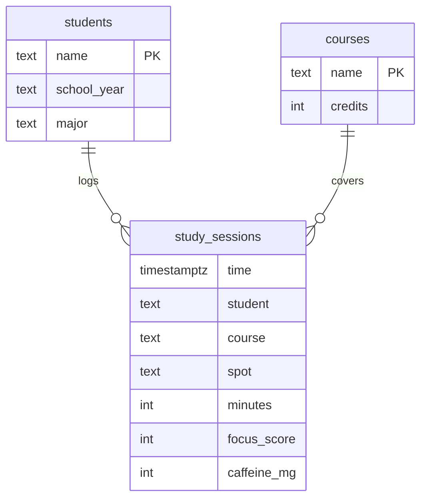
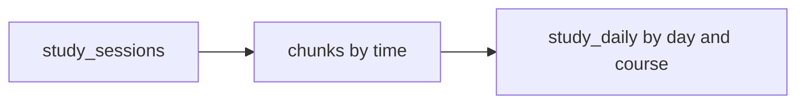

# Focus Log schema

This is the picture behind the live demo. `students` and `courses` are ordinary PostgreSQL tables. `study_sessions` is a hypertable: same SQL, with TimescaleDB splitting the rows into time chunks. `study_daily` does not exist until `sql/05_continuous_aggregate.sql`. It is a continuous aggregate, a summary TimescaleDB refreshes for you.

The demo joins on `name`. It does not declare foreign keys, so the livestream paste stays in two steps: create the hypertable, then load the lookup tables and the sessions.

## Tables

`students.name` matches `study_sessions.student`. `courses.name` matches `study_sessions.course`. One student logs many sessions. One course shows up on many sessions.

## From rows to a summary

Chunks are storage chapters inside the hypertable. The demo does not create a chunk table by hand. After the seed, `timescaledb_information.chunks` lists those chapters. Each one holds about a week.

`study_daily` stores one row per course per Eastern day: total minutes, average focus, and how many sessions that day contained. A dashboard reads that summary instead of scanning every session.

## What is stored

| Column | Where | What it means |
| --- | --- | --- |
| `name` | `students`, `courses` | The join key. Full names, so a result grid is readable on a livestream. |
| `school_year` | `students` | Freshman, sophomore, junior, or senior. Color for the story, not used in the main queries. |
| `major` | `students` | Computer Science, Mathematics, or English. Shown when the log is joined back to the student. |
| `credits` | `courses` | 4 for the three technical courses, 3 for Writing. |
| `time` | `study_sessions` | Start of the hour, stored as `timestamptz`. The wall clock is America/New_York. |
| `student` | `study_sessions` | Who studied. Also the `segmentby` column, so one student's rows sit together inside a chunk. |
| `course` | `study_sessions` | Databases, Data Structures, Calculus, or Writing. |
| `spot` | `study_sessions` | Library, Cafe, or Dorm. |
| `minutes` | `study_sessions` | 30 on a normal session, 50 when someone is cramming Databases in the last week. |
| `focus_score` | `study_sessions` | About 35 to 98. Higher means the hour went better. |
| `caffeine_mg` | `study_sessions` | 0, 80, or 160. |
| `day`, `total_minutes`, `avg_focus`, `sessions` | `study_daily` | Computed. Not typed in. `time_bucket` builds the day, and the continuous aggregate stores the rollup. |

2,880 sessions are stored: 6 students, 16 hours a day (8:00am through 11:00pm Eastern), 30 days ending yesterday.

## What the queries compute

`time_bucket` does not add a column to `study_sessions`. It labels rows at read time so `GROUP BY` can average an hour or sum a day. The continuous aggregate is the version of that summary that stays on disk and gets refreshed.

| Question | Computed from |
| --- | --- |
| Best hour to study | `time` grouped into clock hours, then `avg(focus_score)` |
| Library vs dorm on weeknights | `time` filtered to Monday–Friday, 5pm–8pm, then `avg(focus_score)` by `spot` |
| Deadline jump | `time` grouped into Eastern days, then `sum(minutes)` by `course` |
| Caffeine vs focus | `caffeine_mg = 160`, then the lowest `focus_score` by student and hour |
| Busiest spot | `count(*)` by `spot` |

## How the planted patterns use those columns

- **Hour and focus.** The seed starts from a score for each clock hour, highest at 10:00 (base 90) and lowest at 23:00 (base 46). Spot and a Jordan penalty are applied after that, then the score is clamped to 35–98. The hour query should show **10 AM at 92.7** and **11 PM at 37.5**.
- **Spot and focus.** From 8:00am to 4:00pm everyone is in the Library except Priya and Sam, who use the Cafe. On weekday evenings from 5:00pm to 8:00pm, Maya, Priya, and Riley are in the Library, and Jordan, Alex, and Sam are in the Dorm. Weekend evenings in that range are the Cafe. From 9:00pm on, everyone is in the Dorm. The Library adds 6 focus points. The Dorm subtracts 8. Weeknight Library focus should be **77.3**, Dorm **60.6**.
- **The last 7 days, course, and minutes.** For the first 23 days each student stays on a home course: Maya and Alex on Databases, Jordan and Sam on Data Structures, Priya on Calculus, Riley on Writing. In the last 7 days Maya, Alex, Jordan, and Sam switch every session to Databases, and those sessions go from 30 minutes to 50. Daily Databases minutes go from **960 to 3,200**. Calculus and Writing stay at **480**. Data Structures has no rows in the final week.
- **Caffeine.** 0mg from 8:00am to 4:00pm, 80mg from 5:00pm to 8:00pm, 160mg from 9:00pm to 11:00pm. Jordan has an extra −8 focus on every session, so the low end of the 160mg rows is **Jordan Blake at 11 PM, focus 35.0**.
